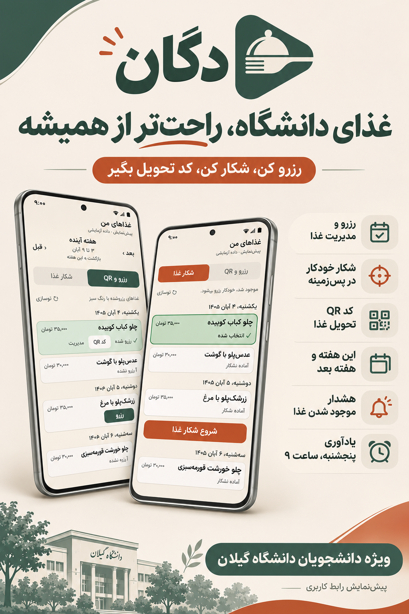

# دگان | Degan

رزرو و مدیریت غذای دانشگاه گیلان، ساده‌تر و سریع‌تر.

**[⬇ دانلود نسخه اندروید](https://github.com/parsaak85/degan/releases/latest/download/Degan.apk)** · [همه نسخه‌ها](https://github.com/parsaak85/degan/releases)

## امکانات

- **رزرو و مدیریت غذا:** خرید، لغو رزرو، گذاشتن برای فروش و برداشتن از فروش.
- **شکار غذا:** غذاهای دلخواهت را انتخاب کن؛ اولین گزینه‌ای که موجود شود خریداری می‌شود.
- **شکار در پس‌زمینه:** نمایش روند شکار و اعلان پیدا شدن غذا.
- **کد QR تحویل:** دسترسی به کد تحویل هر غذای رزروشده.
- **برنامه هفتگی:** جابه‌جایی بین این هفته و هفته بعد، با تاریخ شمسی و نمایش سبز غذاهای رزروشده.
- **کیف پول:** نمایش و تازه‌سازی موجودی، هشدار کمبود اعتبار و ادامه پرداخت در مرورگر گوشی.
- **یادآوری رزرو:** اعلان پنجشنبه‌ها ساعت ۹ صبح.
- **چند حساب و چند سلف:** ذخیره و انتخاب حساب‌های مختلف و انتخاب سلف.

## نصب

[فایل APK](https://github.com/parsaak85/degan/releases/latest/download/Degan.apk) را دانلود و روی گوشی نصب کن. مناسب اندروید ۷ به بالا، نسخه ۶۴بیتی ARM64.

برای دریافت یادآوری و اعلان شکار، مجوز اعلان‌ها را فعال کن.

دگان برنامه‌ای غیررسمی است و وابستگی سازمانی به دانشگاه گیلان یا سامانه سماد ندارد.
