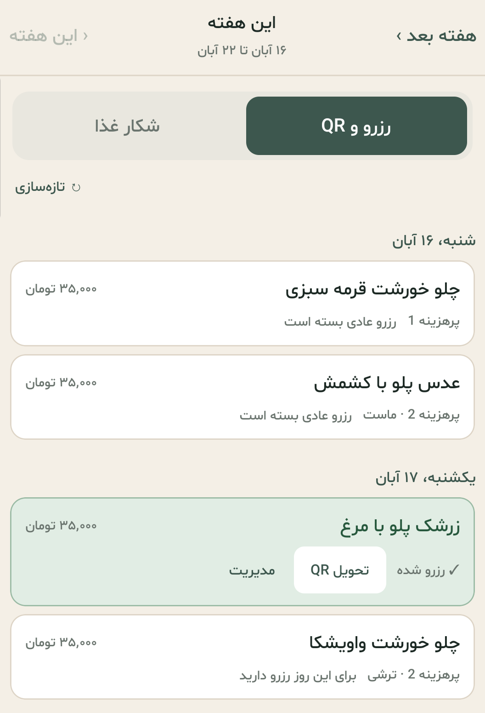

# Degan | دگان

A simpler way to reserve and manage meals at the University of Guilan.

**[Download the Android APK](https://github.com/parsaak85/degan/releases/latest/download/Degan.apk)** · [Latest release](https://github.com/parsaak85/degan/releases/latest)

  

Actual app screenshot, cropped to exclude account details.

## Features

- Reserve and cancel meals, list reserved meals for sale, and withdraw listings.
- Hunt for selected meals in the background, with progress and success notifications.
- View pickup QR codes for reserved meals.
- Browse this week and next week, with Jalali dates and reserved meals highlighted in green.
- Check wallet balance, receive low-balance alerts, and continue payment in the phone's browser.
- Receive a weekly reservation reminder on Thursdays at 9 AM.
- Save and switch between multiple accounts and dining halls.
- Persian interface designed for mobile use.

## Install

Download and install the [latest APK](https://github.com/parsaak85/degan/releases/latest/download/Degan.apk). Requires **Android 7 or later, ARM64**.

Allow notifications to receive reservation reminders and food-hunting updates.

Degan is an unofficial app and is not affiliated with the University of Guilan or Samad.
